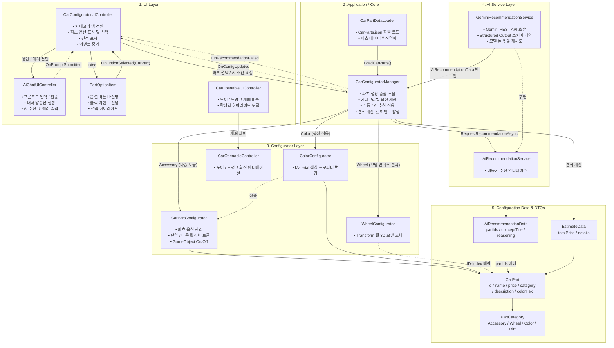
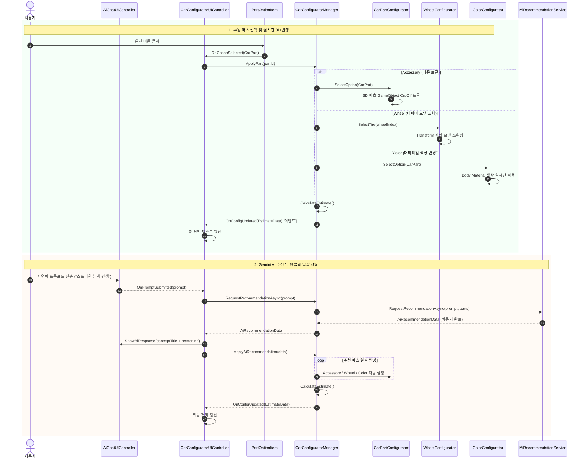

# 🚗 AI 기반 자동차 컨피규레이터 (AI Car Configurator)

Unity URP 기반의 실시간 3D 자동차 커스터마이징 및 AI 추천 시스템입니다.
사용자가 자연어로 원하는 차량의 용도, 예산 및 선호 스타일을 입력하면 AI(Gemini)가 카탈로그 내 최적의 파츠 조합을 추천하고, Unity 3D 차량 모델에 실시간으로 일괄 적용하며 최종 견적을 산출합니다.

---

## 🎯 프로젝트 범위 (Project Scope)

본 프로젝트는 **SRS(Software Requirements Specification v0.1)** 에 정의된 요구사항을 준수하여 제작되었습니다.

### 포함 범위 (In-Scope)
- **3D 차량 컨피규레이터**: 차량 외장 색상, 휠 모델, 악세서리 실시간 시각화 및 부품 변경
- **자연어 요구사항 입력**: 사용자 목적, 예산, 선호 스타일을 반영한 자연어 프롬프트 처리
- **AI 기반 옵션 추천**: 등록된 파츠 카탈로그 내 최적 부품 조합 추천 및 추천 사유(Reasoning) 제공
- **실시간 견적 계산**: 기본 차량 가격 + 장착된 파츠 가격의 실시간 동기화
- **사용자 수정 및 인터랙션**: AI 추천 결과에 대한 사용자 수동 재구성 및 도어/트렁크 개폐 인터랙션

### 제외 범위 (Out-of-Scope)
- 실제 차량 결제 및 금융/계약 연동
- 제조사 ERP/생산 시스템 연동
- 실제 차량 물리 주행 제어 및 정밀 성능 측정

---

## 📌 주요 기능 (Key Features)

- **🎨 외장 색상 커스터마이징 (Color)**
  - URP 셰이더 머티리얼 프로퍼티(`Color_CF7B3627`)를 실시간으로 변경하여 외장 바디 컬러 적용.
- **🛞 휠 모델 교체 (Wheel)**
  - 전용 `WheelConfigurator`를 통해 타이어 부모 오브젝트 하위의 3D 휠 모델을 실시간 스위칭.
- **🧰 악세서리 다중 탈부착 (Accessory)**
  - 루프랙, 사이드스텝 등 부품별 독립적인 활성화(On/Off) 토글 및 다중 장착 지원.
- **✨ 선택 옵션 실시간 하이라이트 (Highlight)**
  - 씬 및 UI에서 현재 장착된 파츠 버튼을 시각적으로 강조하여 직관적인 조작감 제공.
- **🚪 도어 & 트렁크 개폐 인터랙션 (Interaction)**
  - `CarOpenableController`를 통한 좌/우 도어 및 트렁크의 부드러운 회전 애니메이션 토글.
- **🤖 AI 스타일링 추천 (AI Recommendation)**
  - Google Gemini API (Structured Outputs)를 활용한 전문 튜닝 컨설팅.
  - 자연어 프롬프트를 분석하여 어울리는 파츠 조합 및 추천 이유를 제공하고 원클릭 일괄 장착.
- **💰 실시간 견적 자동 계산 (Real-time Estimate)**
  - 파츠 장착/해제 및 AI 추천 반영 시 C# 이벤트(`OnConfigUpdated`)를 통해 총 견적 금액 실시간 동기화.

---

## 🛡️ AI 가드레일 및 안정성 설계 (AI Guardrails & Reliability)

SRS 요구사항(Section 3.3 & 3.6)에 따라 시스템 신뢰성과 데이터 정합성을 보장하기 위해 다음과 같은 가드레일이 구현되어 있습니다.

> [!IMPORTANT]
> **1. 카탈로그 범위 제약 (Catalog Scope Constraint)**
> Gemini API의 **Structured Outputs (`responseSchema`)** 를 적용하여, AI가 임의의 가상 부품을 생성하지 못하도록 `CarParts.json`에 정의된 Enum ID만을 반환하도록 서버 레벨에서 강제합니다.

> [!TIP]
> **2. 검증된 내부 데이터 기반 견적 산출 (Deterministic Pricing)**
> AI 응답 텍스트에 포함된 가격을 신뢰하지 않고, 추천된 파츠 ID를 기반으로 Unity 내부의 등록된 카탈로그 가격(`CarPart.price`) 및 기본 차량 가격(`baseVehiclePrice`)을 C#에서 직접 합산하여 할루시네이션(Hallucination) 가격 오차를 원천 차단합니다.

> [!NOTE]
> **3. 다단계 모델 폴백 및 재시도 (Multi-stage Fallback & Retry)**
> 네트워크 지연이나 API 429/503 오류 발생 시 지수 백오프(1초, 2초) 간격으로 경량 모델로 자동 폴백합니다:
> `gemini-3.5-flash` ➔ `gemini-3.5-flash-lite` ➔ `gemini-flash-lite-latest`

> [!WARNING]
> **4. 장애 격리 및 서비스 연속성 (Failure Isolation)**
> AI API 장애나 네트워크 단절 시에도, 수동 컨피규레이터 기능은 중단 없이 정상 동작을 유지합니다.

> [!CAUTION]
> **5. API Key 보안 관리 (Security)**
> API 인증 키는 소스 코드에 하드코딩하지 않으며, `StreamingAssets/Config/config.json` 또는 시스템 환경 변수(`GEMINI_API_KEY`)를 통해 분리 관리됩니다.

---

## 🏗️ 시스템 아키텍처 (System Architecture)



---

## 🔄 핵심 워크플로우 (Core Workflow)



---

## 📋 데이터 인터페이스 및 규격 (Data Specifications)

### 1. 파츠 데이터 스키마 (`CarPart`)
```json
{
  "id": "color_matte_black",
  "name": "매트 블랙",
  "price": 500000,
  "category": 2,
  "description": "세련되고 묵직한 무광 블랙 바디 컬러",
  "colorHex": "#1C1C1C"
}
```

### 2. AI 추천 교환 규격 (`AiRecommendationData`)
```json
{
  "conceptTitle": "스포티 다크 에디션",
  "reasoning": "스포티한 분위기를 위해 매트 블랙 바디 컬러와 19인치 경량 단조 휠, 에어로 카본 스포일러를 조합했습니다.",
  "partIds": [
    "color_matte_black",
    "wheel_mesh_y_forged",
    "acc_carbon_spoiler"
  ]
}
```

---

## 📊 SRS 요구사항 추적 매트릭스 (Requirements Traceability)

| 요구사항 ID | 구분 | 요구사항 명칭 | 구현 요소 및 검증 기준 | 상태 |
|---|---|---|---|---|
| **REQ-FUNC-001** | 기능 | 사용자 요구사항 입력 | `AiChatUIController`를 통한 자연어 프롬프트 입력 및 빈 입력 유효성 검사 | ✅ 구현 완료 |
| **REQ-FUNC-002** | 기능 | 사용자 요구사항 분석 | Gemini API 자연어 프롬프트 파싱 및 컨셉/스타일 의도 추출 | ✅ 구현 완료 |
| **REQ-FUNC-003** | 기능 | AI 차량 옵션 추천 | `GeminiRecommendationService` 카탈로그 기반 옵션 추천 생성 | ✅ 구현 완료 |
| **REQ-FUNC-004** | 기능 | 추천 차량 구성 적용 | `CarConfiguratorManager.ApplyAiRecommendation()`을 통한 3D 일괄 반영 | ✅ 구현 완료 |
| **REQ-FUNC-005** | 기능 | 수동 옵션 변경 | 색상/휠/악세서리 탭 UI 버튼 조작 시 실시간 3D 반영 및 견적 동기화 | ✅ 구현 완료 |
| **REQ-FUNC-006** | 기능 | 차량 견적 계산 | `CalculateEstimate()`를 통한 기본가 + 선택 파츠 합산 및 중복 방지 | ✅ 구현 완료 |
| **REQ-FUNC-007** | 기능 | 예산 조건 고려 | 프롬프트 요구 예산 및 가성비 고려 추천 프롬프트 지침 제공 | ✅ 구현 완료 |
| **REQ-FUNC-008** | 기능 | 추천 근거 제공 | `AiRecommendationData.reasoning` UI 말풍선 상세 출력 | ✅ 구현 완료 |
| **REQ-PERF-001** | 성능 | UI 응답성 | 옵션 변경 즉시 Material 프로퍼티/GameObject 활성화로 지연 최소화 | ✅ 구현 완료 |
| **REQ-PERF-002** | 성능 | AI 추천 응답 상태 | AI 호출 중 전송 버튼 비활성화 및 처리 상태 UI 표시 | ✅ 구현 완료 |
| **REQ-SEC-001** | 보안 | API Key 보호 | `config.json` 및 시스템 환경 변수를 통한 인증정보 분리 관리 | ✅ 구현 완료 |
| **REQ-REL-001** | 신뢰성 | AI 요청 실패 처리 | 429/503 지수 백오프 재시도, 다단계 모델 폴백 및 수동 모드 유지 | ✅ 구현 완료 |
| **REQ-OBS-001** | 관측성 | 주요 동작 로그 | Unity Console을 통한 API 요청/응답, 파츠 장착, 견적 변경 로그 출력 | ✅ 구현 완료 |

---

## 👥 팀 역할 분담 (Team Roles & Responsibilities)

본 프로젝트는 2인 프로젝트팀으로 구성되어 아래와 같이 역할을 분담하여 구현 및 검증을 진행했습니다.

| 담당 영역 | 담당자 | 세부 업무 내용 |
|---|---|---|
| **Unity / 3D / UI** | **조성민** | • 차량 3D 모델 세팅 및 URP 셰이더 머티리얼 구성<br/>• 부품 교체 로직(`WheelConfigurator`, `CarPartConfigurator`, `ColorConfigurator`)<br/>• 전체 컨피규레이터 UI 및 견적 표시 UI 구현 |
| **AI / Data / 견적** | **박창민** | • 차량 및 부품 데이터 모델(`CarPart`) 및 `CarParts.json` 설계<br/>• Google Gemini API 연동 및 Structured Outputs 스키마 정의<br/>• 다단계 모델 폴백, 재시도 및 AI 에러 핸들링<br/>• 실시간 견적 산출 로직(`CalculateEstimate`) 및 데이터 바인딩 |
| **공동 협업 (Co-work)** | **공동** | • AI ↔ Unity 데이터 교환 인터페이스(`AiRecommendationData`) 정의<br/>• 통합 시나리오 테스트 및 사용자 인터랙션 검증<br/>• Git 버전 관리 및 프로젝트 배포 환경 구성 |

---

## 📂 프로젝트 구조 (Project Structure)

```text
Assets/
├── Scripts/
│   ├── Configurators/       # 3D 모델 및 머티리얼 조작 컴포넌트
│   │   ├── CarPartConfigurator.cs   # 악세서리 다중 토글 및 공통 컨피규레이터
│   │   ├── ColorConfigurator.cs     # 차량 외장 색상 머티리얼 제어
│   │   ├── WheelConfigurator.cs     # 타이어 3D 모델 스위처
│   │   └── CarOpenableController.cs # 도어/트렁크 회전 애니메이션
│   ├── Core/                # 핵심 비즈니스 로직 및 전체 UI 컨트롤러
│   │   ├── CarConfiguratorManager.cs
│   │   └── CarConfiguratorUIController.cs
│   ├── Data/                # 데이터 모델 및 로더
│   │   ├── CarPart.cs
│   │   ├── CarPartDataLoader.cs     # CarParts.json 파일 파서
│   │   └── PartOptionItem.cs        # 옵션 버튼 바인딩 및 선택 하이라이트
│   ├── DTOs/                # 데이터 전송 객체
│   │   ├── AIRecommendationData.cs
│   │   └── EstimateData.cs
│   ├── Services/            # AI 연동 서비스
│   │   ├── IAiRecommendationService.cs
│   │   └── GeminiRecommendationService.cs
│   └── UI/                  # 보조 UI 컨트롤러
│       ├── AiChatUIController.cs    # AI 채팅 말풍선 UI
│       └── CarOpenableUIController.cs # 도어/트렁크 제어 UI
├── Data/
│   └── CarParts.json        # 차량 파츠 카탈로그 데이터
└── StreamingAssets/
    └── Config/
        └── config.json      # Gemini API Key 설정 파일
```

---

## 🚀 시작하기 (Getting Started)

### 요구 환경

- **Unity**: Unity 6 (또는 2022.3 LTS 이상, Universal Render Pipeline 권장)
- **Platform**: Windows Standalone / macOS

### Gemini API 키 설정

AI 추천 기능을 사용하려면 Google Gemini API 키 설정이 필요합니다.

1. `Assets/StreamingAssets/Config/config.json` 파일을 열거나 새로 생성합니다.
2. 아래와 같이 API 키를 입력합니다:
   ```json
   {
     "apiKey": "YOUR_GEMINI_API_KEY"
   }
   ```
   *(또는 시스템 환경 변수에 `GEMINI_API_KEY`를 등록하여 사용할 수 있습니다.)*

### 씬 실행

1. Unity Editor에서 메인 씬을 엽니다.
2. **Play** 버튼을 클릭하여 컨피규레이터를 실행합니다.
3. 카테고리 탭(Color, Wheel, Accessory)을 클릭하여 부품을 교체하거나, **AI** 탭에서 원하는 컨셉을 자연어로 입력해보세요.
